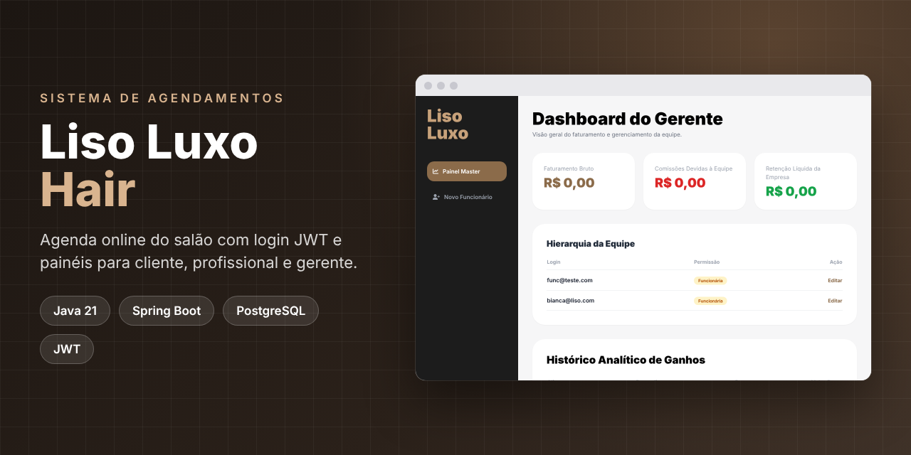
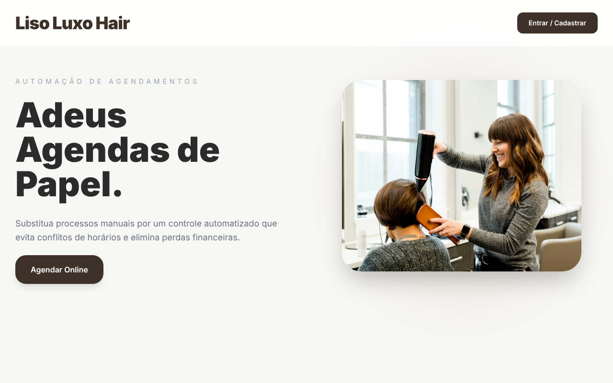
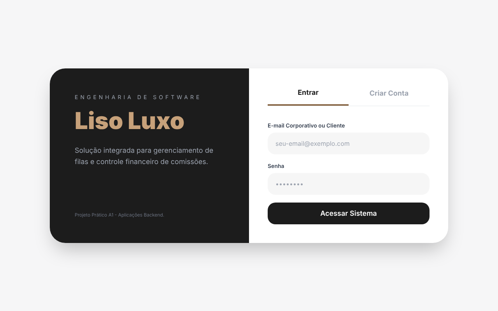
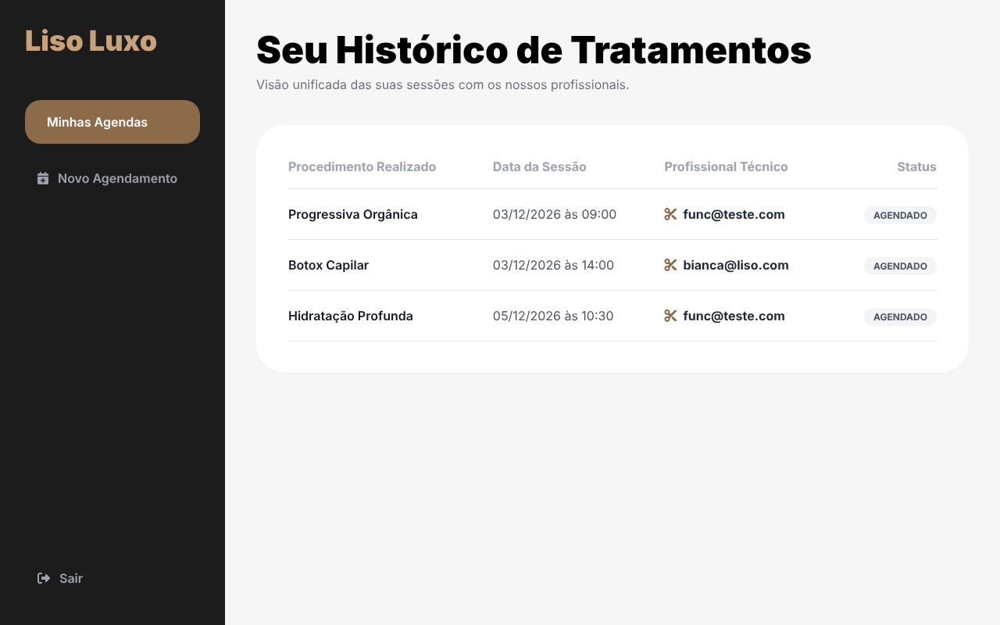
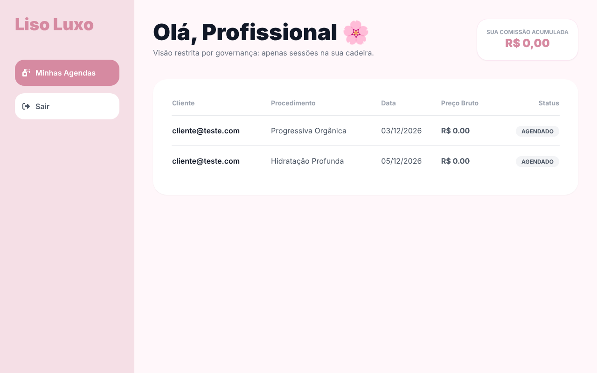
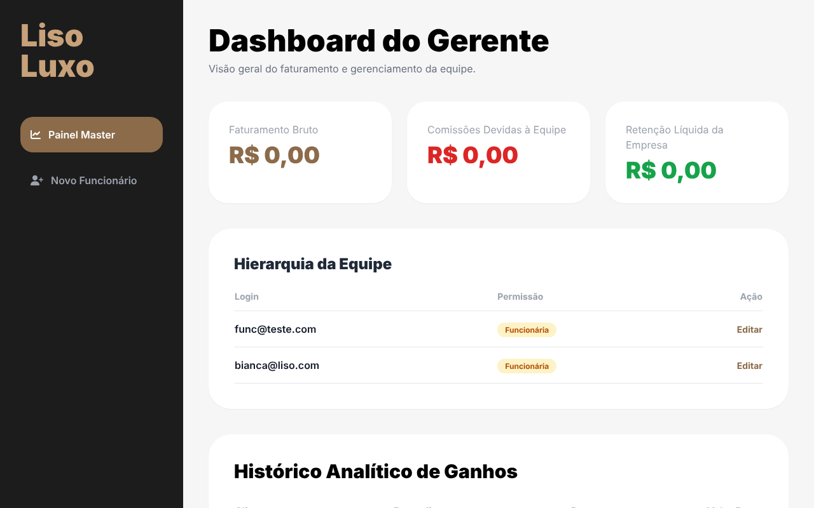

<p align="center">
  
</p>

<h1 align="center">💇‍♀️ Liso Luxo Hair — Sistema de Agendamentos</h1>

<p align="center">
  Back-end em <b>Spring Boot</b> para o salão <b>Liso Luxo Hair</b>: cadastro de clientes, profissionais e serviços,
  agendamentos e telas por perfil (cliente, profissional e gerente), com autenticação via <b>JWT</b>.
</p>

<p align="center">
  
  
  
  
  
  
</p>

<p align="center">
  <a href="#-sobre-o-projeto">Sobre</a> •
  <a href="#-funcionalidades">Funcionalidades</a> •
  <a href="#️-telas">Telas</a> •
  <a href="#-endpoints-da-api">Endpoints</a> •
  <a href="#-regras-de-negócio">Regras de negócio</a> •
  <a href="#-como-executar">Como executar</a> •
  <a href="#-estrutura-do-projeto">Estrutura</a>
</p>

---

## 📌 Sobre o projeto

O objetivo é substituir a agenda de papel do salão por um sistema de agendamentos online: a cliente escolhe o
serviço, a profissional e o horário; a profissional vê só a própria agenda; e a gerência cadastra a equipe e
acompanha todos os atendimentos.

A aplicação segue o padrão em camadas do Spring (`controller` → `Service` → `repository` → `model`), usa
**Spring Data JPA** com **PostgreSQL**, autenticação **stateless com JWT** e telas em HTML (Thymeleaf + Tailwind
via CDN) servidas pela própria aplicação. Depois do login, cada perfil é levado ao seu painel.

> 🚧 **Em desenvolvimento.** Os agendamentos ainda não trazem o preço do serviço, então os valores financeiros dos
> painéis (preço bruto, faturamento e comissões) aparecem zerados. As regras de negócio do documento
> [`docs/Regras-de-negocio.docx`](docs/Regras-de-negocio.docx) são o planejamento e ainda não estão implementadas.

## ✨ Funcionalidades

| | Recurso | Descrição |
|---|---|---|
| 🔐 | **Login com JWT** | `/auth/login` devolve o token e o perfil; a tela redireciona para o painel certo |
| 👥 | **Três perfis** | `USER` (cliente), `FUNC` (profissional) e `ADMIN` (gerente), com rotas protegidas por perfil |
| 📅 | **Agendamento** | A cliente agenda escolhendo profissional, serviço e data/hora |
| 💇‍♀️ | **Agenda da profissional** | Cada profissional vê apenas os atendimentos da própria cadeira |
| 📊 | **Painel do gerente** | Lista a equipe, cadastra funcionárias e mostra todos os agendamentos |
| ✂️ | **Serviços** | Cadastro e listagem de serviços com duração e preço |
| 🐳 | **Docker** | `Dockerfile` multi-stage e `docker-compose.yml` com PostgreSQL |

## 🖼️ Telas

<table>
  <tr>
    <td align="center"><b>Início</b><br></td>
    <td align="center"><b>Login</b><br></td>
  </tr>
  <tr>
    <td align="center"><b>Painel da cliente</b><br></td>
    <td align="center"><b>Agenda da profissional</b><br></td>
  </tr>
  <tr>
    <td align="center"><b>Painel do gerente</b><br></td>
    <td align="center"><b>Celular</b><br></td>
  </tr>
</table>

## 🔌 Endpoints da API

Todas as rotas, exceto as públicas, exigem o cabeçalho `Authorization: Bearer <token>`.

| Método | Rota | Acesso | Descrição |
|---|---|---|---|
| `POST` | `/auth/login` | público | Recebe `login` e `password`; devolve `token` e `role` |
| `POST` | `/auth/register` | público | Cria usuário com `login`, `password` e `role` |
| `POST` | `/cliente/register` | público | Cria usuário cliente (`USER`) |
| `POST` | `/cliente/agendamento` | cliente | Agenda com `profissionalLogin`, `servicoId`, `data_hora` e `status` |
| `GET` | `/cliente/meus-agendamentos` | cliente | Agendamentos da cliente logada |
| `GET` | `/cliente/profissionais` | cliente | Lista as profissionais |
| `GET` | `/profissional/meus-agendamentos` | profissional | Agenda da profissional logada |
| `POST` | `/gerente/funcionarios` | gerente | Cadastra funcionária (`FUNC` por padrão) |
| `GET` | `/gerente/funcionarios` | gerente | Lista a equipe |
| `GET` | `/gerente/agendamentos` | gerente | Todos os agendamentos |
| `POST` | `/servico/novo-servico` | autenticado | Cadastra serviço (`nome_servico`, `duracao_estimada`, `preco`) |
| `GET` | `/servico/listar` | autenticado | Lista os serviços |

Telas: `/`, `/login`, `/cliente`, `/funcionario` e `/gerente`.

## 📋 Regras de negócio

O documento [`docs/Regras-de-negocio.docx`](docs/Regras-de-negocio.docx) define as regras planejadas para a agenda:

- **Disponibilidade:** sem choque de horários para a mesma profissional, agenda aberta para os próximos 60 dias e
  1 hora de intervalo bloqueada depois de atendimentos de 4 horas.
- **Status do agendamento:** Pendente, Confirmado, Cancelado e No-Show (a falta gera taxa de 20%).
- **Cancelamento:** gratuito até 5 horas antes, multa sobre o sinal em cancelamentos tardios e no máximo
  2 reagendamentos por mês.
- **Notificações:** confirmação imediata e lembretes 24h e 2h antes do horário.

## 🚀 Como executar

**Pré-requisitos:** JDK 21 e um PostgreSQL com o banco `agendamentos_db` (usuário `postgres`). O Maven Wrapper
(`mvnw`) já vem no projeto.

### Localmente

```bash
git clone https://github.com/kauaxp77/LuxoHair.git
cd LuxoHair
# Linux/macOS
DB_PASSWORD=sua_senha JWT_SECRET=um_segredo ./mvnw spring-boot:run
# Windows (PowerShell)
$env:DB_PASSWORD="sua_senha"; $env:JWT_SECRET="um_segredo"; .\mvnw spring-boot:run
```

A aplicação sobe em `http://localhost:8081` e o Hibernate cria as tabelas (`ddl-auto=update`). Para ter
usuários de teste, crie-os pela API, por exemplo:

```bash
curl -X POST http://localhost:8081/auth/register -H "Content-Type: application/json" \
  -d '{"login":"gerente@teste.com","password":"123","role":"ADMIN"}'
```

Esse fluxo (cadastro, login de cada perfil, painéis e agendamentos) foi testado com PostgreSQL 16. O teste
automatizado (`./mvnw test`) também precisa do banco disponível.

### Com Docker Compose (aplicação + PostgreSQL)

```bash
docker compose up -d --build
```

A aplicação fica em `http://localhost:8082` e o PostgreSQL na porta `5432`. Esse caminho segue os arquivos do
projeto, mas não foi testado nesta revisão.

## 📁 Estrutura do projeto

```
LuxoHair/
├── src/main/java/com/example/ProjetoBack/
│   ├── controller/          # Endpoints REST e controllers das telas
│   ├── Service/             # Regras de negócio
│   ├── repository/          # Spring Data JPA
│   ├── model/               # Entidades: Agendamento, Servico e User (com o perfil em UserRole)
│   ├── dto/                 # DTOs de requisição e resposta
│   ├── infra/security/      # JWT: TokenService, SecurityFilter e SecurityConfiguration
├── src/main/resources/
│   ├── templates/           # Telas HTML (Thymeleaf), com o JavaScript embutido
│   │   └── standby/         # Telas antigas fora de uso
│   ├── static/              # Scripts de uma versão anterior (as telas atuais não os usam)
│   └── application.properties
├── docs/
│   ├── Regras-de-negocio.docx  # Regras de negócio planejadas
│   ├── screenshots/            # Prints das telas
│   └── banner.png
├── Dockerfile               # Build multi-stage (Maven + JDK 21)
├── docker-compose.yml       # Aplicação + PostgreSQL 15
└── pom.xml
```

## 🛠️ Tecnologias

- **Java 21** e **Spring Boot 3.2** (Web, Data JPA, Validation, Security, Thymeleaf)
- **Spring Security** com **JWT**
- **PostgreSQL 15**
- **Thymeleaf** e **Tailwind CSS** (CDN) nas telas
- **Lombok**
- **Docker** e **Docker Compose**

## 👨‍💻 Autor

Desenvolvido por **[kauaxp77](https://github.com/kauaxp77)** e equipe

<p align="center">⭐ Se curtiu o projeto, deixe uma estrela!</p>
